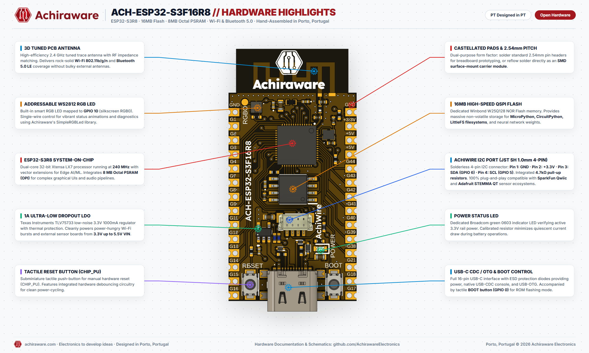
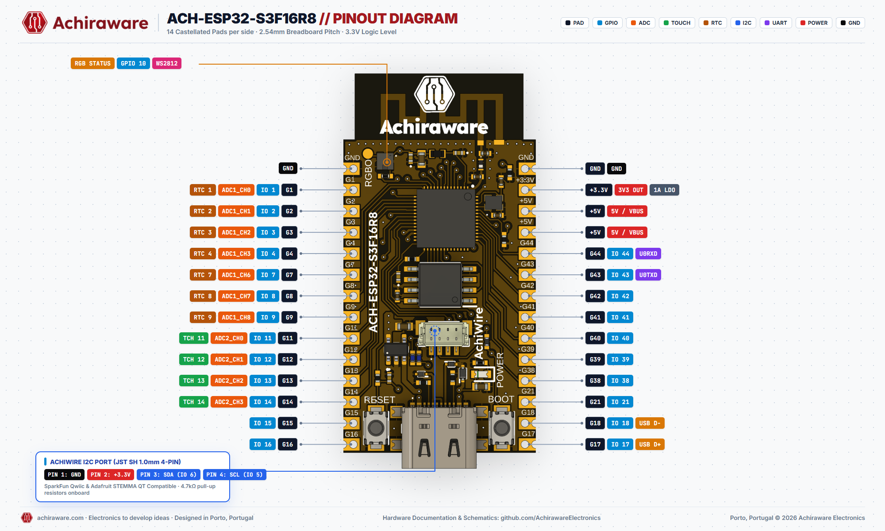

<div align="center">

# ACH-ESP32-S3F16R8

**High-Performance Dual-Core ESP32-S3 Development Board with 16MB Flash, 8MB PSRAM & Solderless I2C**

[](#hardware-files)
[](https://achiraware.com)
[](https://achiraware.com)
[](#quickstart-guide)
[](https://achiraware.com/product/ach-esp32-s3f16r8/)

<br>



</div>

---

## 📖 Overview

The **ACH-ESP32-S3F16R8** by **Achiraware Electronics** is an enterprise-grade development board powered by the **Espressif ESP32-S3R8** dual-core Xtensa LX7 SoC running at **240 MHz**. Designed and assembled in Vila Nova de Gaia / Porto, Portugal, it is specifically engineered for high-demand edge computing, machine learning (TinyML), computer vision, retro emulation, and responsive IoT applications.

Equipped with massive **16 MB High-Speed NOR Flash** and **8 MB Octal PSRAM (OPI)**, the board removes all memory bottlenecks for heavy frameworks like MicroPython, CircuitPython, LVGL graphical interfaces, and neural net inference.

### Key Highlights
- **Engineered in Porto, Portugal:** Built with industrial-grade passive components and strict quality control.
- **Extreme Memory:** 16 MB QSPI Flash + 8 MB Octal PSRAM for rich graphics and deep buffer audio/video pipelines.
- **AchiWire Plug-and-Play I2C:** Onboard 4-pin JST SH 1.0mm connector with 4.7kΩ pull-ups, 100% plug-compatible with **SparkFun Qwiic** and **Adafruit STEMMA QT** sensors.
- **Robust Power Stage:** Texas Instruments TLV75733 low-noise LDO delivering up to **1000 mA (1A)** at 3.3V, easily handling 2.4 GHz Wi-Fi TX current bursts and multiple external sensor loads.
- **Smart RGB LED:** Built-in addressable WS2812 RGB LED on **GPIO 10** for instant diagnostics and animated alerts.
- **Dual Form Factor:** Standard 2.54 mm breadboard-friendly pin spacing plus castellated edges for SMD module reflow soldering.

---

## 📐 Hardware Architecture & Highlights

| Feature | Specification |
|:---|:---|
| **Microcontroller** | Espressif ESP32-S3R8 (Dual-Core 32-bit Xtensa LX7 @ 240 MHz, Vector Instructions) |
| **Wireless** | 2.4 GHz Wi-Fi (802.11 b/g/n) + Bluetooth 5.0 LE with high-efficiency tuned 3D PCB trace antenna |
| **Flash Memory** | 16 MB Winbond W25Q128 High-Speed Quad-SPI NOR Flash |
| **PSRAM** | 8 MB Embedded Octal SPI (OPI) PSRAM |
| **SRAM** | 512 KB Internal SRAM + 16 KB RTC SRAM |
| **Power Input (VIN)** | 3.3V to 5.5V via VIN pin or 5V via USB-C |
| **Voltage Regulator** | Texas Instruments TLV75733 (3.3V @ 1000 mA output, thermal shutdown, short-circuit protection) |
| **USB Interface** | Full 16-pin USB Type-C with ESD protection diodes (Native USB-CDC console + USB-OTG) |
| **I2C Connector** | JST SH 1.0mm 4-Pin AchiWire Port (Qwiic / STEMMA QT compatible) with 4.7kΩ pull-ups |
| **Indicators** | Green Power LED (3.3V rail) + Addressable WS2812 Smart RGB LED (GPIO 10) |
| **Buttons** | Subminiature Tactile Reset Button (CHIP_PU) + Boot Button (GPIO 0) |
| **Mounting** | 2.54 mm (0.1") pitch headers + castellated SMD solder pads |

---

## 📌 Pinout Diagram & Reference

<div align="center">

</div>

### 🔌 AchiWire I2C Connector (JST SH 1.0mm 4-Pin)
Connect any SparkFun Qwiic or Adafruit STEMMA QT breakout board without soldering:

| Pin # | Wire Color | Signal | Notes |
|:---:|:---:|:---|:---|
| **1** | Black | **GND** | System Ground |
| **2** | Red | **+3.3V** | 3.3V Power Rail (from 1A LDO) |
| **3** | Blue | **SDA (GPIO 6)** | I2C Data Line (onboard 4.7kΩ pull-up) |
| **4** | Yellow | **SCL (GPIO 5)** | I2C Clock Line (onboard 4.7kΩ pull-up) |

---

### 📋 Header Pin Mapping

#### Left Header (Pins 1 – 14)
| Pin # | Silkscreen | GPIO | Primary Function | Secondary / Alternate Functions |
|:---:|:---|:---|:---|:---|
| 1 | **GND** | - | Power Ground | 0V Reference |
| 2 | **G1** | GPIO 1 | Digital I/O | RTC 1, ADC1_CH0 |
| 3 | **G2** | GPIO 2 | Digital I/O | RTC 2, ADC1_CH1 |
| 4 | **G3** | GPIO 3 | Digital I/O | RTC 3, ADC1_CH2 |
| 5 | **G4** | GPIO 4 | Digital I/O | RTC 4, ADC1_CH3 |
| 6 | **G7** | GPIO 7 | Digital I/O | RTC 7, ADC1_CH6 |
| 7 | **G8** | GPIO 8 | Digital I/O | RTC 8, ADC1_CH7 |
| 8 | **G9** | GPIO 9 | Digital I/O | RTC 9, ADC1_CH8 |
| 9 | **G11** | GPIO 11 | Digital I/O | Touch 11, ADC2_CH0 |
| 10 | **G12** | GPIO 12 | Digital I/O | Touch 12, ADC2_CH1 |
| 11 | **G13** | GPIO 13 | Digital I/O | Touch 13, ADC2_CH2 |
| 12 | **G14** | GPIO 14 | Digital I/O | Touch 14, ADC2_CH3 |
| 13 | **G15** | GPIO 15 | Digital I/O | General Purpose I/O |
| 14 | **G16** | GPIO 16 | Digital I/O | General Purpose I/O |

#### Right Header (Pins 1 – 14)
| Pin # | Silkscreen | GPIO | Primary Function | Secondary / Alternate Functions |
|:---:|:---|:---|:---|:---|
| 1 | **GND** | - | Power Ground | 0V Reference |
| 2 | **3V3** | - | +3.3V Power Output | Regulated 3.3V Rail (up to 1000 mA) |
| 3 | **5V** | - | +5V Power In/Out | Direct VBUS from USB-C or External Supply |
| 4 | **5V** | - | +5V Power In/Out | Tied to 5V rail |
| 5 | **G44** | GPIO 44 | UART0 RX (U0RXD) | Serial Console Receive |
| 6 | **G43** | GPIO 43 | UART0 TX (U0TXD) | Serial Console Transmit |
| 7 | **G42** | GPIO 42 | Digital I/O | General Purpose I/O |
| 8 | **G41** | GPIO 41 | Digital I/O | General Purpose I/O |
| 9 | **G40** | GPIO 40 | Digital I/O | General Purpose I/O |
| 10 | **G39** | GPIO 39 | Digital I/O | General Purpose I/O |
| 11 | **G38** | GPIO 38 | Digital I/O | General Purpose I/O |
| 12 | **G21** | GPIO 21 | Digital I/O | General Purpose I/O |
| 13 | **G18** | GPIO 18 | USB D- | Native USB Full-Speed Data - |
| 14 | **G17** | GPIO 17 | USB D+ | Native USB Full-Speed Data + |

---

## 🚀 Quickstart Guide

### 1. Arduino IDE Setup

1. In Arduino IDE, open **Preferences** (`Ctrl + ,`) and add the official Espressif board manager URL:
   ```
   https://raw.githubusercontent.com/espressif/arduino-esp32/gh-pages/package_esp32_index.json
   ```
2. Navigate to **Tools > Board > Boards Manager**, search for `esp32` by Espressif Systems, and click **Install**.
3. Select **Tools > Board > ESP32S3 Dev Module**.
4. Configure the IDE options:
   - **Flash Size:** `16MB (128Mb)`
   - **Flash Mode:** `QIO 80MHz`
   - **PSRAM:** `OPI PSRAM` ⚠️ *(Critical to enable the full 8MB)*
   - **USB CDC On Boot:** `Enabled` *(Allows Serial monitor via native USB-C)*
   - **Upload Mode:** `UART0 / Hardware CDC`
   - **Partition Scheme:** `16M Flash (3MB APP/9.9MB FATFS)` or `Default 4MB with spiffs`

#### Driving the Onboard WS2812 RGB LED (GPIO 10) with SimpleRGBLed
Install **SimpleRGBLed** via the Arduino Library Manager (search for `SimpleRGBLed` by `pablojosep` or install from [GitHub](https://github.com/AchirawareElectronics/SimpleRGBLed)):

```cpp
#include <SimpleRGBLed.h>

#define RGB_PIN   10
#define NUM_LEDS  1

SimpleRGBLed led(NUM_LEDS);

void setup() {
  Serial.begin(115200);

  // Initialize hardware RMT driver on GPIO 10
  if (!led.begin(RGB_PIN)) {
    Serial.println("Error: could not initialize WS2812 RGB LED");
    while (true) delay(1000);
  }

  led.setBrightnessPercent(40); // 40% brightness
}

void loop() {
  // Achiraware Crimson Red (RGB)
  led.setRGB(163, 24, 30);
  delay(1000);

  // Cyan Blue (Named color)
  led.setColor("cyan");
  delay(1000);

  // Amber Gold (Named color)
  led.setColor("orange");
  delay(1000);

  // Status blink (3 times in yellow)
  led.blink("yellow", 3, 200, 200);
  delay(1000);
}
```

#### Solderless I2C Scanner (AchiWire Port)
```cpp
#include <Wire.h>

#define ACHIWIRE_SDA 6
#define ACHIWIRE_SCL 5

void setup() {
  Serial.begin(115200);
  while (!Serial && millis() < 3000);
  
  Serial.println("\n--- Achiraware AchiWire I2C Scanner ---");
  Wire.begin(ACHIWIRE_SDA, ACHIWIRE_SCL);
}

void loop() {
  byte count = 0;
  for (byte address = 1; address < 127; ++address) {
    Wire.beginTransmission(address);
    if (Wire.endTransmission() == 0) {
      Serial.printf("Found I2C device at address: 0x%02X\n", address);
      count++;
    }
  }
  if (count == 0) Serial.println("No I2C devices found on AchiWire port.");
  Serial.println("Scan complete. Retrying in 5 seconds...\n");
  delay(5000);
}
```

---

### 2. MicroPython Setup

1. Download the latest official ESP32-S3 firmware with **Octal-SPIRAM (OPI)** support from [micropython.org](https://micropython.org/download/ESP32_GENERIC_S3/).
2. Flash using `esptool.py`:
   ```bash
   esptool.py --chip esp32s3 --port COMx erase_flash
   esptool.py --chip esp32s3 --port COMx --baud 460800 write_flash -z 0x0 ESP32_GENERIC_S3-*.bin
   ```
3. Test onboard RGB LED via REPL:
   ```python
   import machine, neopixel, time
   np = neopixel.NeoPixel(machine.Pin(10), 1)

   while True:
       np[0] = (163, 24, 30)  # Achiraware Red
       np.write()
       time.sleep(1)
       np[0] = (0, 229, 255)  # Cyan
       np.write()
       time.sleep(1)
   ```

---

### 3. PlatformIO (`platformio.ini`)
```ini
[env:ach-esp32-s3f16r8]
platform = espressif32
board = esp32-s3-devkitc-1
framework = arduino
monitor_speed = 115200

board_build.mcu = esp32s3
board_build.f_cpu = 240000000L
board_build.f_flash = 80000000L
board_build.flash_mode = qio
board_upload.flash_size = 16MB

build_flags = 
    -DBOARD_HAS_PSRAM
    -mfix-esp32-psram-cache-issue
    -DARDUINO_USB_CDC_ON_BOOT=1
```

---

## 📁 Hardware & Design Files

| File | Description | Download Link |
|:---|:---|:---:|
| **Schematic (PDF)** | Complete electrical schematic with BOM annotations | [schematic.pdf](hardware/schematic.pdf) |
| **3D CAD Model (STEP)** | High-precision 3D model for custom enclosure CAD | [ACH-ESP32-S3F16R8.step](hardware/ACH-ESP32-S3F16R8.step) |
| **Mechanical Outline (DXF)** | 2D mechanical footprint and mounting dimensions | [Sketch.dxf](hardware/Sketch.dxf) |
| **Ultra HD Highlights** | 2000x1200 Architecture breakdown infographic | [Highlights PNG](hardware/ACH-ESP32-S3F16R8_Hardware_Highlights.png) |
| **Ultra HD Pinout** | 2000x1200 Full pinout reference diagram | [Pinout PNG](hardware/ACH-ESP32-S3F16R8_Pinout_Diagram.png) |

---

## 🛒 Where to Buy

Get authentic, factory-tested boards shipped directly from Porto, Portugal:

👉 **[Official Achiraware Store — Buy ACH-ESP32-S3F16R8](https://achiraware.com/product/ach-esp32-s3f16r8/)**

- **Worldwide & Fast EU Shipping:** Shipped via registered mail / courier across Europe and globally.
- **Support & Inquiries:** [customerservice@achiraware.com](mailto:customerservice@achiraware.com) | [achiraware.com](https://achiraware.com)

---

## 📄 License & Attribution

Designed and open-sourced by **Achiraware Electronics** (Vila Nova de Gaia / Porto, Portugal).  
Hardware documentation and design files are released under the **CERN Open Hardware Licence v2 - Permissive** (CERN-OHL-P). Software libraries and example code are licensed under the **MIT License**.
